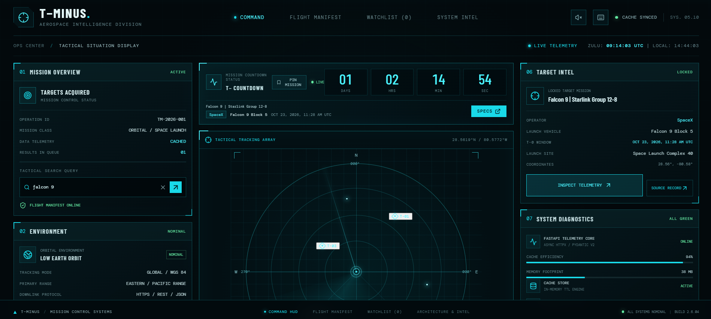
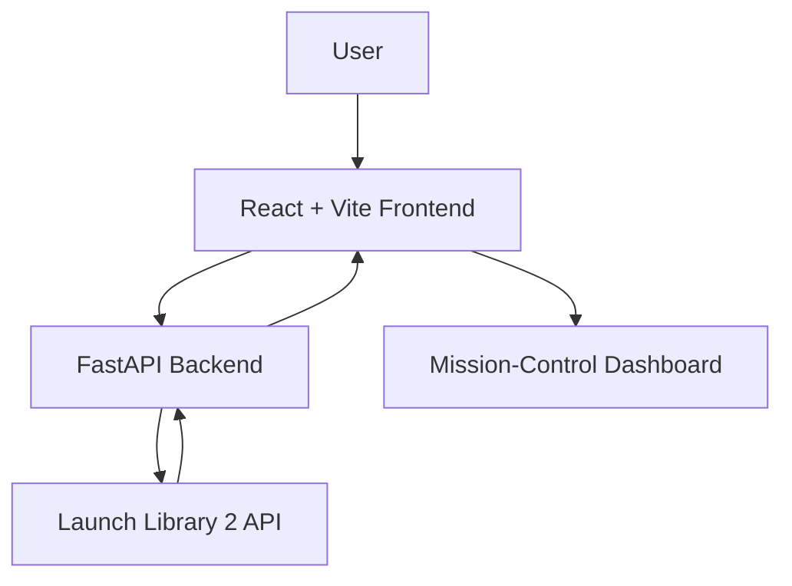

# 🚀 T-Minus — Aerospace Mission Control

<p align="center">
  <strong>From launch countdowns to mission intelligence.</strong>
  <br />
  A space-inspired mission-control dashboard for exploring rocket launches and tracking upcoming missions.
</p>

<p align="center">
  
  
  
  
</p>

---

## 🛰️ Mission Preview

<p align="center">
  
</p>

*T-Minus brings a mission-control aesthetic to rocket-launch discovery, combining a tactical dashboard interface with launch data from the Space Devs Launch Library 2 API.*


## ✨ Features

- **Mission Search** — Find rocket launches using the dashboard's search interface.
- **Mission-Control HUD** — A dark, aerospace-inspired interface with telemetry-style panels and launch information.
- **Launch Data Integration** — Retrieve launch information through a Python backend connected to Launch Library 2.
- **Launch Countdown** — Display countdown information for scheduled launches where launch-time data is available.
- **Flight Manifest** — Browse and filter launch information, if enabled in the current build.
- **Backend API** — Organize launch data behind a dedicated API instead of calling the upstream service directly from every UI component.
- **API Documentation** — Explore available endpoints through FastAPI's interactive documentation.

## 🛠️ Tech Stack

| Technology | Purpose |
|---|---|
| React | Interactive user interface |
| Vite | Frontend development and build tooling |
| Python | Backend development |
| FastAPI | REST API and request handling |
| Launch Library 2 | Rocket-launch data source |
| CSS | Dashboard styling and responsive layout |
| Pytest | Backend testing |

## 🏗️ Architecture



The frontend handles user interaction and presentation. The backend acts as the interface between the dashboard and the external launch-data service.

## 📁 Project Structure

```text
T-minus/
├── backend/
│   ├── app/
│   ├── tests/
│   └── requirements.txt
├── frontend/
│   ├── src/
│   ├── public/
│   └── package.json
├── docs/
│   └── screenshots/
│       └── dashboard.png
├── docker-compose.yml
├── .gitignore
├── LICENSE
└── README.md
```

*The structure above is representative; adjust it to match the files in your repository.*

## 🚀 Getting Started

### Prerequisites

- Python 3.11 or later
- Node.js and npm
- Git

### 1. Clone the repository

```bash
git clone https://github.com/Raksha-qq/T-minus.git
cd T-minus
```

### 2. Start the backend

Open a terminal in the project root:

```bash
cd backend
python -m venv .venv
```

Activate the virtual environment.

**Windows PowerShell:**

```powershell
.\.venv\Scripts\Activate.ps1
```

**macOS / Linux:**

```bash
source .venv/bin/activate
```

Install dependencies and start the API:

```bash
pip install -r requirements.txt
uvicorn app.main:app --reload
```

The API should be available at `http://localhost:8000`.

Interactive API documentation is available at `http://localhost:8000/docs` when the server is running.

### 3. Start the frontend

Open a second terminal:

```bash
cd frontend
npm install
npm run dev
```

Open the local URL printed by Vite, usually `http://localhost:5173`.

Keep both servers running while using the application.

## 📡 API Endpoints

The backend exposes launch-data endpoints through its REST API. Confirm the exact routes in the running API documentation at `/docs`.

| Method | Endpoint | Purpose |
|---|---|---|
| `GET` | `/` | Root endpoint and API information |
| `GET` | `/api/health` | Backend health check |
| `GET` | `/api/launches` | Retrieve launch information |

Additional endpoints can be documented here as they are implemented.

## 🧪 Testing

To run the backend tests, activate the backend virtual environment and run:

```bash
cd backend
pytest -v
```

Use the test results from your own environment when reporting the number of passing tests.

## 🐳 Docker

If Docker Compose is configured for both services, start the application with:

```bash
docker compose up --build
```

Use the service URLs defined by your Docker Compose configuration.

## 🔭 Future Improvements

- Deploy the frontend and backend for public access.
- Improve responsive layouts for mobile and tablet screens.
- Add more detailed mission and launch-site information.
- Improve loading, error, and empty-result states.
- Expand automated tests and CI checks.

## 👩‍💻 Author

**Raksha**

GitHub: [@Raksha-qq](https://github.com/Raksha-qq)

## 📄 License

This project is distributed under the license included in the repository. See [LICENSE](LICENSE) for details.

---

<p align="center">
  <sub>Built to explore the next frontier, one launch at a time. 🚀</sub>
</p>
